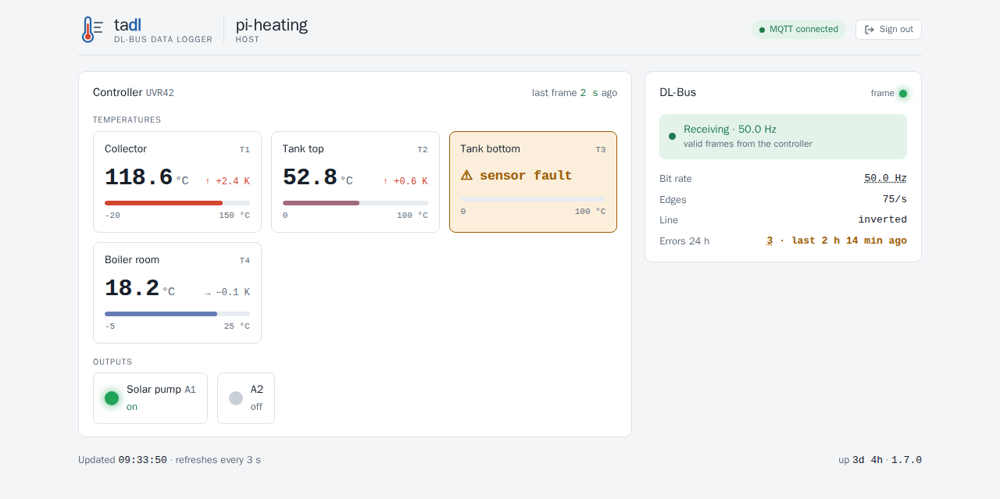
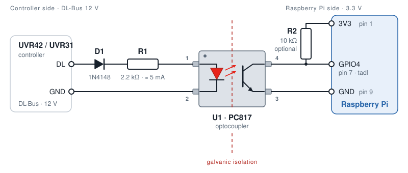

# tadl – Deutsche Kurzfassung

🇬🇧 [Full documentation in English](README.md)

  

**tadl liest den DL-Bus eines Heizungsreglers UVR42 oder UVR31 von Technische Alternative auf einem
Raspberry Pi und zeigt die Temperaturen live an.**

Die Solar- und Heizungsregler UVR42 und UVR31 von [Technische Alternative](https://www.ta.co.at/)
senden ihre Temperaturen und Ausgangszustände über den **DL-Bus**, die Datenleitung für die
Datenlogger von TA. Über einen Optokoppler an einen GPIO-Pin eines Raspberry Pi angeschlossen,
macht tadl daraus Messwerte:

- die **Temperaturen** aller Fühler und den **Zustand der Ausgänge** (Pumpen, Ventile),
- per **MQTT** bei jeder deutlichen Änderung und in einem festen Intervall veröffentlicht, z. B. für
  Node-RED, Home Assistant oder ioBroker,
- live auf einer **eingebauten Webseite**, mit eigenen Fühlernamen, einem Balken pro Temperatur und
  dem Verlauf der letzten 15 Minuten,
- über eine **HTTPS-REST-API** (TLS 1.3) für Skripte und Monitoring, mit einem eigenen Token je
  Aufrufer; tadl speichert davon nur den SHA-256-Hash und schreibt ins Log, wer zugreift.

Bitrate und Polarität der Leitung erkennt tadl selbst; ein invertierender Optokoppler braucht keine
Einstellung. Keine Cloud, keine Datenbank: ein einzelnes Programm und eine YAML-Datei.

## In fünf Schritten

1. **Herunterladen:** Das Archiv für deinen Pi gibt es unter
   [Releases](https://github.com/womat/tadl/releases/latest): `armv6` für Pi 1 und Zero,
   `armv7` für 32-Bit-Systeme, `arm64` für 64-Bit-Systeme.
2. **Installieren:** System-User `tadl` anlegen, Programm und `config.yaml` nach `/opt/tadl`
   kopieren, Zertifikat erzeugen. Alles gehört root, der Dienst darf `etc/` nur lesen – wer
   Konfiguration oder Token-Datei schreiben kann, kann sich selbst einen Token eintragen.
3. **Konfigurieren:** `env: prod`, Reglertyp (`uvr42` oder `uvr31`), GPIO-Pin und MQTT-Broker;
   optional Namen und Bereiche der Fühler für die Webseite (`datalogger.sensors`). Dann je
   Aufrufer einen Token anlegen, z. B. `sudo /opt/tadl/bin/tadl token add browser`; er wird nur
   dieses eine Mal angezeigt, siehe [Tokens](README.md#tokens).
4. **Anschließen:** Der DL-Bus führt **12 V** – nie direkt an einen GPIO-Pin, die GPIOs vertragen
   höchstens 3,3 V. Die Datenleitung über einen Vorwiderstand an die LED eines **Optokopplers**
   (z. B. PC817), dessen Transistor den GPIO-Pin gegen GND zieht, mit Pull-up auf 3,3 V; siehe
   [Wiring](README.md#wiring):

   
5. **Starten:** mit der Unit aus dem Archiv (`contrib/tadl.service`, läuft abgeschottet), dann
   `https://<dein-pi>:8443/` im Browser öffnen und den Token eingeben.

**Auf 3.2.0:** Die Konfiguration wird strenger geprüft. Ein ungültiger Eintrag in `allowedIPs` oder
`blockedIPs`, eine nicht lesbare `mqtt.connection` oder ein Hash unter zwei Namen in der
Token-Datei verhindert jetzt den Start (Exit 78). Siehe [Upgrading to 3.2.0](README.md#upgrading-to-320).

**Von 2.x auf 3.0.0:** `apiKey` gibt es nicht mehr, stattdessen `tokenFile` und `tadl token add`;
HTTPS nur noch mit TLS 1.3. Die Schritte stehen unter
[Upgrading to 3.0.0](README.md#upgrading-to-300).

Die genauen Befehle stehen im [Quick start](README.md#quick-start), alle Einstellungen unter
[Configuration](README.md#configuration). Ohne Regler lässt sich tadl mit dem Emulator `dlbussim`
testen, der in jedem Release-Archiv mitkommt, siehe [Testing without a controller](README.md#testing-without-a-controller).

## Lizenz

MIT, siehe [`LICENSE`](LICENSE).
